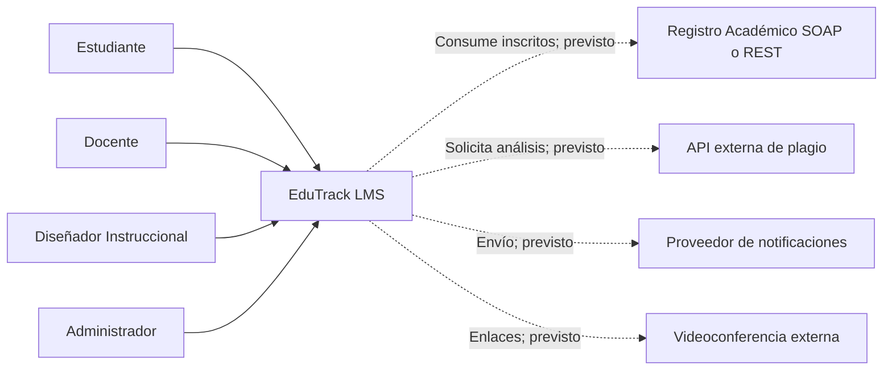
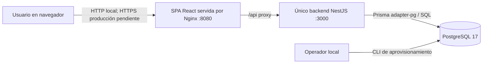
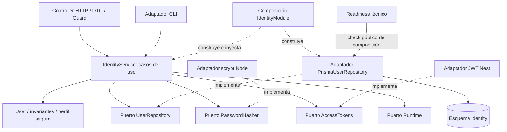
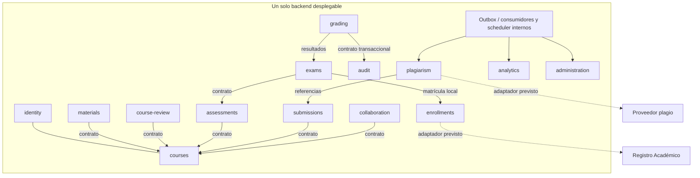

# Diagramas C4

Diagramas Mermaid versionados. Los elementos «previstos» no están desplegados. Los niveles de abstracción siguen C4 aunque se usa sintaxis flowchart portable.

## Nivel 1: contexto objetivo

## Nivel 2: contenedores actuales

La CLI usa los mismos casos de uso/adaptadores y es una herramienta local, no otro servicio desplegable. Nginx y PostgreSQL son infraestructura; solo NestJS contiene el backend de negocio. Docker Compose es local y una réplica.

## Nivel 3: componentes actuales del backend

## Vista objetivo de componentes, pendientes

Este diagrama resume responsabilidades, no autoriza dependencias nuevas; `modules.json` define el grafo previsto. Redis, objetos y cola externos requieren decisión/implementación posterior; no aparecen como contenedores actuales.
