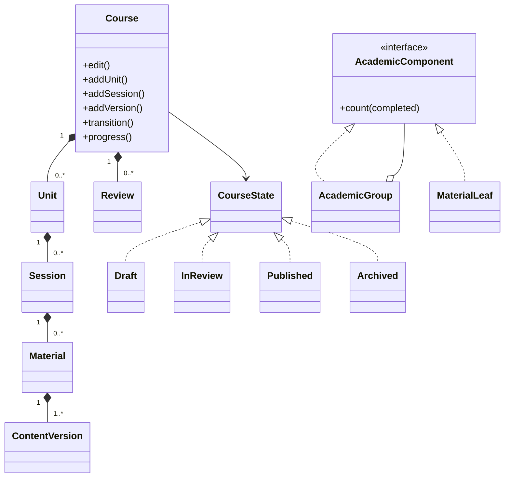
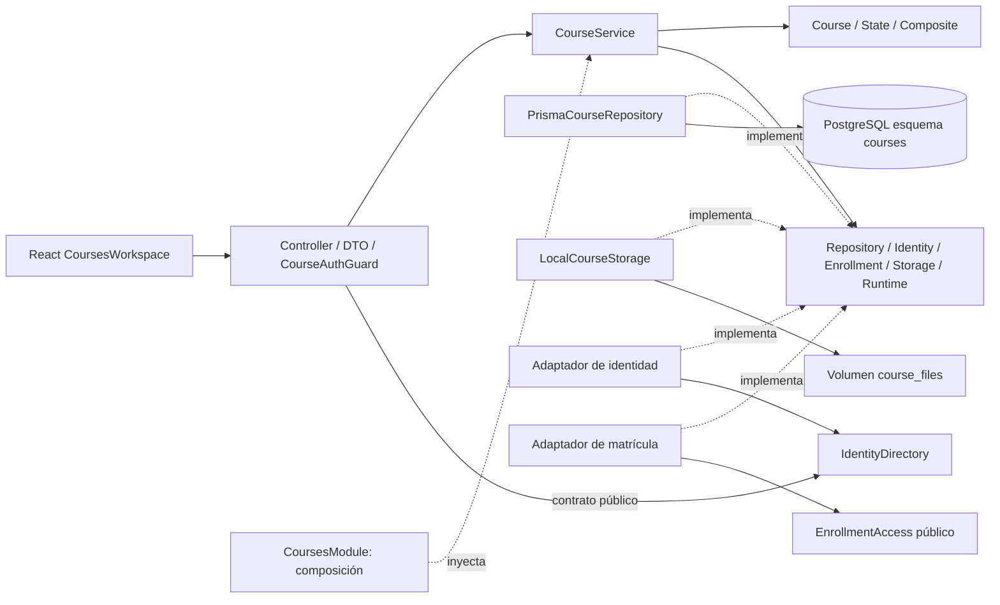
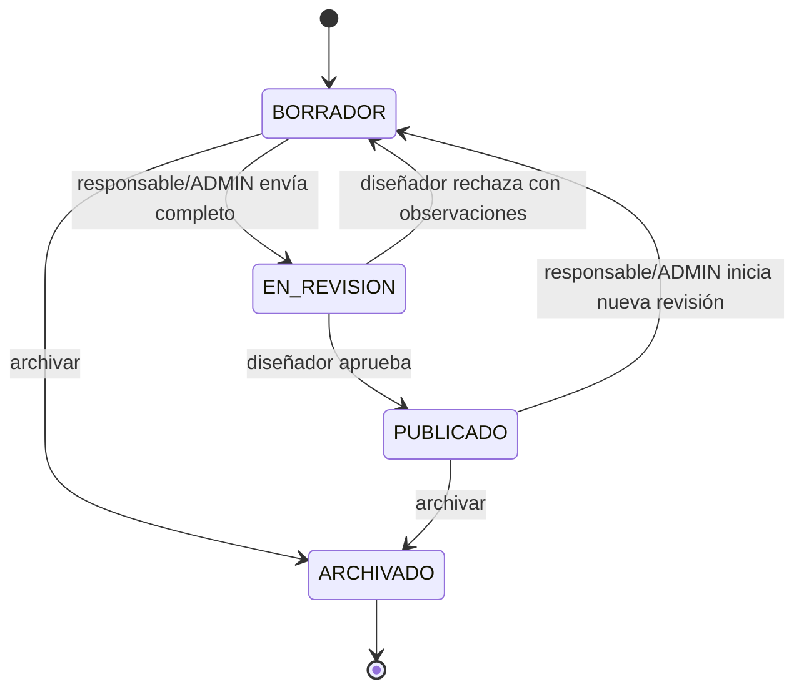

# Clases y componentes académicos

Los espacios planificados `materials` y `course-review` no acceden a estas tablas ni están conectados como módulos ficticios. Sus capacidades se implementan cohesivamente en courses según ADR-006. Matrícula institucional sigue pendiente; adaptador por defecto deniega y el fixture solo se habilita explícitamente.

