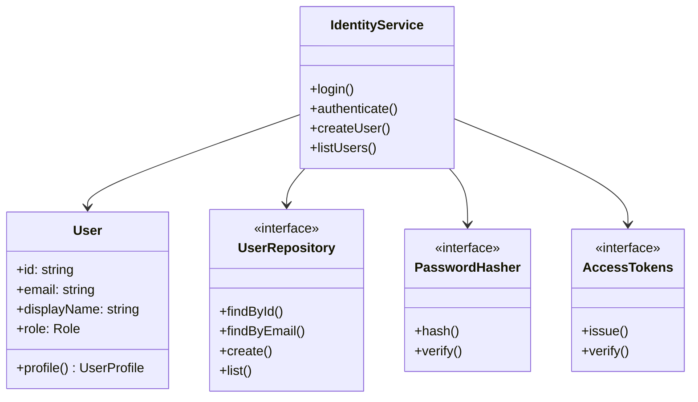
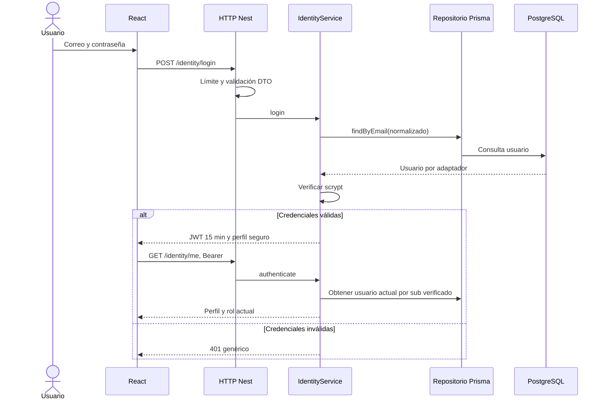
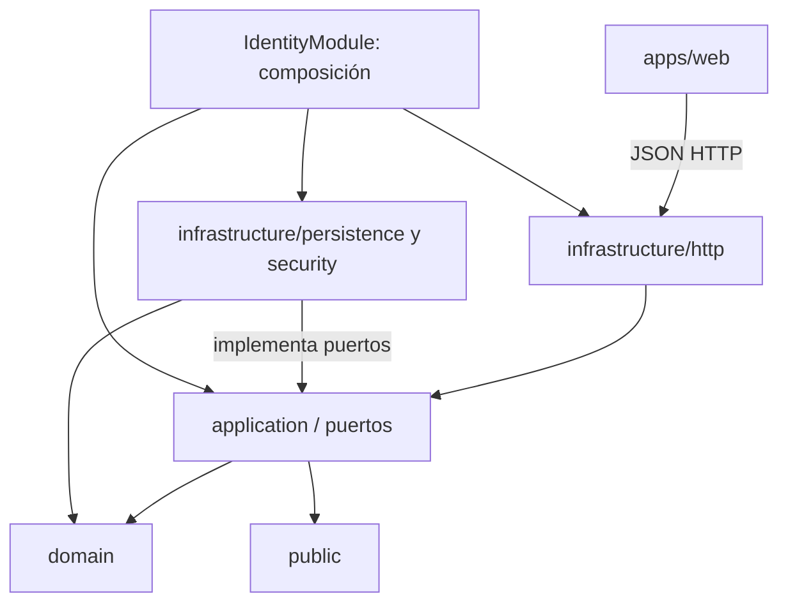
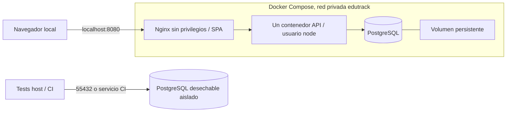

# Modelo 4+1

## Vista lógica

Identidad actual: User protege email/nombre/rol/estado/versión y produce UserProfile. IdentityService coordina repositorio transaccional/hash/token/sesiones/recuperación por puertos. El SMTP sale desde un consumidor interno del outbox de recuperación. Cada módulo futuro posee su modelo; no se comparte una entidad User global con Prisma. Detalle de fase 2 en ADR-005 y el contrato de API.

Modelo académico: estructura/progreso Composite y ciclo State implementados en Courses, según [clases y componentes](CURSOS_DIAGRAMAS.md). Calificación Strategy, interacción Observer/eventos e integraciones externas permanecen pendientes; no hay clases vacías para aparentar patrones.

## Vista de procesos

Acceso implementado:

Examen previsto (CU-03): autorización de matrícula/ventana → snapshot/vencimiento → autoguardado versionado durable cada ≤15 s → reconexión/reenvío → finalización idempotente → nota/auditoría/outbox atómicos → proyecciones asíncronas internas. Esta secuencia todavía no es ejecutable. Sincronización y plagio se aislarán con scheduler/consumidores dentro del mismo backend.

## Vista de desarrollo

Workspaces y pruebas AST preservan la dirección; dominio/aplicación sin dependencias externas. Esquema y migraciones dentro de API, CLI en infraestructura del módulo. Los trece módulos planificados mantienen carpetas, no servicios ficticios.

## Vista física

Producción futura requiere HTTPS/TLS ≥1.2, varias réplicas del mismo backend, BD recuperable, backups verificados, secretos administrados, scheduler con lease, límites de recursos y observabilidad. AWS del informe es una opción documentada, no un despliegue realizado. Compose una réplica no satisface EAC-02.

## +1: escenarios que conectan las vistas

| Escenario | Estado | Vistas / evidencia |
| --- | --- | --- |
| CU-13, administración de identidad | Fase 2 funcional | Alta/edición/roles/estado/perfil, sesiones revocables, contraseñas y correo, eventos; PostgreSQL/SMTP reales y UI |
| CU-03, examen con desconexión | Pendiente | Intento/snapshot, procesos de ACK/reenvío, almacenamiento durable; EAC-01/03 |
| CU-08, cambio de nota | Pendiente | Strategy, transacción nota/auditoría, tabla append-only; EAC-04 |
| CU-10, aprobación | Pendiente | State y versión revisada, contrato review/courses; EAC-05 |
| CU-12, sincronización | Pendiente | Puerto legado, scheduler interno, conciliación idempotente; EAC-06 |
